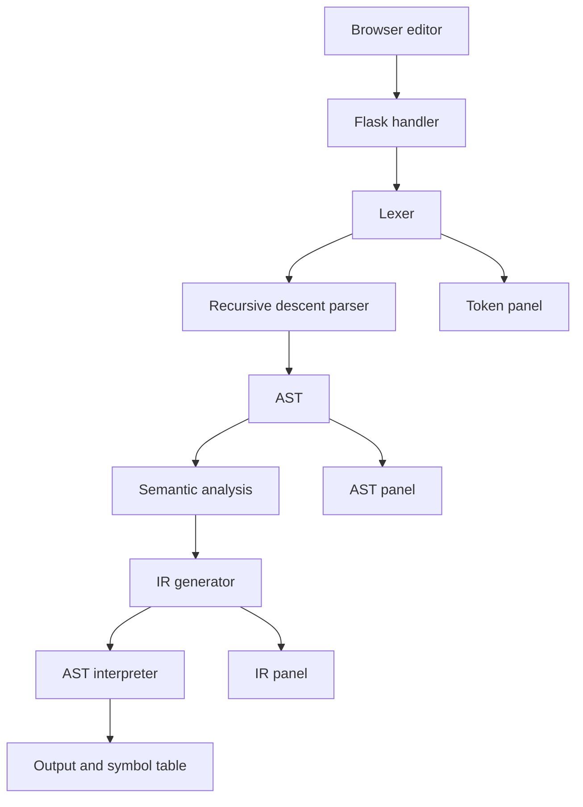

# MiniLang Compiler Lab
An intermediate Compiler Design project in Python/Flask. The browser editor accepts user-written MiniLang code and displays tokens, AST, semantic validation, intermediate representation, final variable values, and program output.

**Scope:** this compiles any code following the MiniLang grammar, not arbitrary Python/C/Java/JavaScript.

## Setup
Requires Python 3.10+.
```bash
cd mini_compiler_project
python -m venv .venv
# Windows PowerShell: .venv\\Scripts\\Activate.ps1
# macOS/Linux: source .venv/bin/activate
pip install -r requirements.txt
python app.py
```
Open http://127.0.0.1:5000, edit the source and click Compile & Run.

## Example
```text
let x = 10;
let y = 3;
print(x * 2 + y);
if (x > y) { print("x is bigger"); } else { print("y is bigger"); }
```
Output:
```text
23
x is bigger
```

## Grammar overview
- Declaration: `let name = expression;`
- Assignment: `name = expression;`
- Output: `print(expression);`
- Condition: `if (expression) { statements } else { statements }`
- Loop: `while (expression) { statements }`
- Expressions: numbers, strings, booleans, identifiers, parentheses, unary `-`/`!`, arithmetic, comparisons.
- Comments: `// comment`

## Architecture


## Tests
`python -m unittest discover -s tests -v`

## Structure
- `app.py`: web server
- `compiler.py`: lexer, parser, semantic checker, IR generator, interpreter
- `templates/index.html`, `static/style.css`: frontend
- `REPORT.md`: course report
- `tests/test_compiler.py`: automated tests

Limitations: no native machine code, functions, arrays, full type checking, or lexical block scope. Future work can add a bytecode VM, type checker, syntax highlighting, and more tests.
