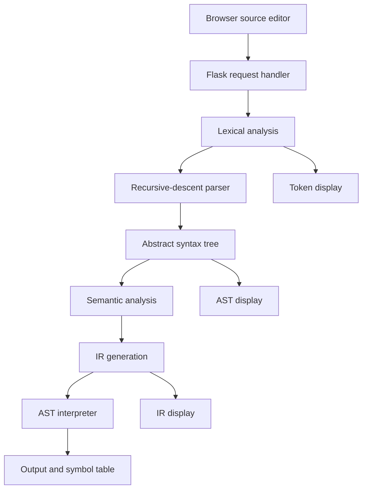

# Mini Compiler for MiniLang — Course Project Report

**Language:** Python | **Frontend:** Flask + HTML/CSS | **Difficulty:** Intermediate

## Abstract
This project implements an interactive compiler pipeline for MiniLang, a custom imperative language. Users enter code in a browser and inspect lexical tokens, an abstract syntax tree (AST), semantic validation, three-address-style intermediate representation (IR), symbol values, and execution output. A small AST interpreter executes programs; native machine code is not generated.

## 1. Problem statement
A fixed example program cannot demonstrate how a compiler handles different inputs. This application provides an editable code frontend. It accepts any program that follows the defined MiniLang grammar. It does not compile arbitrary Python, C, Java, or JavaScript because those languages need separate parsers and execution backends.

## 2. Objectives
1. Recognise tokens and retain source positions.
2. Parse statements and expressions with recursive descent.
3. Build an AST.
4. Check variable declaration/use.
5. Generate intermediate code.
6. Execute valid programs and display output.
7. Present all major phases in a web interface.

## 3. Language features
Keywords: `let`, `print`, `if`, `else`, `while`, `true`, `false`. Literals: integers, decimals, strings, booleans. Operators: `+ - * / % == != < > <= >= = !`. Statements: declarations, assignments, print, if/else, while. Comments start with `//`.

### EBNF
```ebnf
program     = { statement } ;
statement   = declaration | assignment | print_stmt | if_stmt | while_stmt ;
declaration = "let" identifier "=" expression ";" ;
assignment  = identifier "=" expression ";" ;
print_stmt  = "print" "(" expression ")" ";" ;
if_stmt     = "if" "(" expression ")" block [ "else" block ] ;
while_stmt  = "while" "(" expression ")" block ;
block       = "{" { statement } "}" ;
expression  = equality ;
equality    = comparison { ("==" | "!=") comparison } ;
comparison  = term { ("<" | ">" | "<=" | ">=") term } ;
term        = factor { ("+" | "-") factor } ;
factor      = unary { ("*" | "/" | "%") unary } ;
unary       = ("!" | "-") unary | primary ;
primary     = number | string | "true" | "false" | identifier | "(" expression ")" ;
```

## 4. Architecture diagram


## 5. Compiler design explanations
### Lexical analysis
The lexer scans characters and groups them into token classes. Whitespace and comments are skipped. Each token stores its type, value, line, and column. An unexpected character produces a lexical diagnostic.

### Syntax analysis
The recursive-descent parser validates the grammar and creates an AST. Expression parsing is split into precedence levels: equality, comparison, addition/subtraction, multiplication/division/modulo, unary, and primary. Thus multiplication binds more tightly than addition.

### Semantic analysis
A declaration set is used to reject variable reads before declaration, assignment to undeclared names, and duplicate declarations. Scope and type checking are intentionally simplified for this course-sized implementation.

### Intermediate code generation
The IR generator emits temporary variables for compound expressions and labels/jumps for branches and loops. Example:
```text
t1 = x * 2
t2 = t1 + y
PRINT t2
```

### Execution
The interpreter evaluates AST expressions and statements. The IR is an inspectable educational output; the program is executed by the AST interpreter, not by native machine code.

## 6. Setup and operation
1. Install Python 3.10+.
2. Create and activate a virtual environment.
3. Install dependencies with `pip install -r requirements.txt`.
4. Start with `python app.py`.
5. Open `http://127.0.0.1:5000`.
6. Edit the source and press **Compile & Run**.

## 7. Sample cases
**Arithmetic input**
```text
let x = 10;
let y = 3;
print(x * 2 + y);
```
Expected output: `23`.

**Conditional input**
```text
let score = 75;
if (score >= 50) { print("pass"); } else { print("fail"); }
```
Expected output: `pass`.

**Loop input**
```text
let i = 0;
while (i < 3) { print(i); i = i + 1; }
```
Expected output:
```text
0
1
2
```

**Semantic error:** `print(missing);` should report that the variable was used before declaration.  
**Syntax error:** `let x = 4` should report that a semicolon was expected.

## 8. Testing
Automated tests cover arithmetic, conditional execution, loops, undeclared variables, and missing semicolons. Run `python -m unittest discover -s tests -v`.

## 9. Limitations and future scope
The language has no functions, arrays, classes, native code generation, comprehensive static type checking, or lexical block scope. Future enhancements include a bytecode virtual machine, richer type checking, syntax highlighting, parser error recovery, and broader test coverage.

## 10. Conclusion
The MiniLang Compiler Lab demonstrates the major compiler phases through an editable frontend. It allows students to test different programs rather than relying on a hard-coded example and provides inspectable outputs for the lexer, parser, semantic checker, and IR generator.
